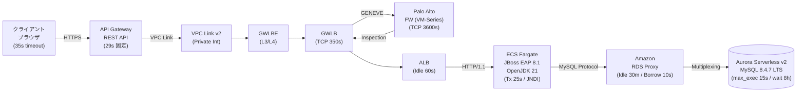
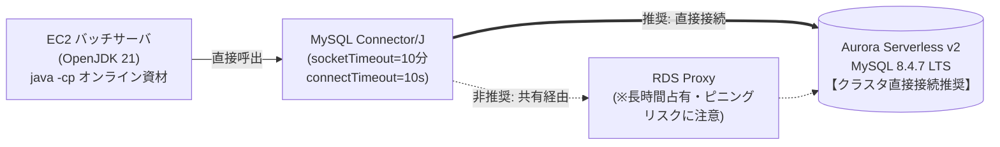
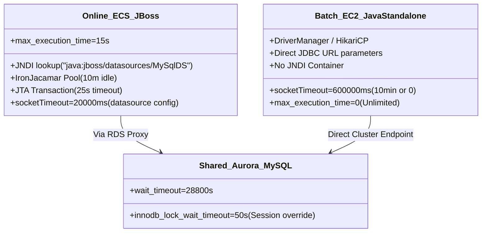

# AWS・データベース・APサーバ エンドツーエンド タイムアウト設計アーキテクチャガイド

本ドキュメントは、クライアントブラウザから API Gateway、GWLB/Palo Alto、ALB、ECS Fargate（JBoss EAP 8.1 / OpenJDK 21）、RDS Proxy、Aurora Serverless v2（MySQL 8.4.7 LTS）、および同一資産を共有する EC2 Java スタンドアロンバッチに至る複雑な多層アーキテクチャにおける、タイムアウト設計の完全解説書です。

---

## 目次

1. [エグゼクティブサマリ：2つの黄金律（不等式）](#1-エグゼクティブサマリ2つの黄金律不等式)
2. [全体アーキテクチャ概要図](#2-全体アーキテクチャ概要図)
3. [小学生でも絶対にわかる！タイムアウトの動作原理とイメージ](#3-小学生でも絶対にわかるタイムアウトの動作原理とイメージ)
4. [タイムアウトが必要になった歴史と背景](#4-タイムアウトが必要になった歴史と背景)
5. [推奨タイムアウト設定値 マスタ比較一覧表（デフォルト vs 推奨値）](#5-推奨タイムアウト設定値-マスタ比較一覧表デフォルト-vs-推奨値)
6. [各コンポーネントの深掘り解説と動作原理](#6-各コンポーネントの深掘り解説と動作原理)
   - 6.1 [ネットワーク・インフラ層 (API GW, GWLB, Palo Alto, ALB)](#61-ネットワークインフラ層-api-gw-gwlb-palo-alto-alb)
   - 6.2 [APサーバ層：JBoss EAP 8.1 (Undertow, JTA, JNDI Pool)](#62-apサーバ層jboss-eap-81-undertow-jta-jndi-pool)
   - 6.3 [DBプロキシ層：Amazon RDS Proxy](#63-dbプロキシ層amazon-rds-proxy)
   - 6.4 [データベース層：Aurora Serverless v2 (MySQL 8.4.7 LTS)](#64-データベース層aurora-serverless-v2-mysql-847-lts)
7. [オンライン vs バッチの設計差異と共有DBの重要論点](#7-オンライン-vs-バッチの設計差異と共有dbの重要論点)
   - 7.1 [JNDI接続（オンライン） vs Connector/J 直接指定（バッチ）](#71-jndi接続オンライン-vs-connectorj-直接指定バッチ)
   - 7.2 [【最重要】バッチ処理はRDS Proxyを経由すべきか？](#72-最重要バッチ処理はrds-proxyを経由すべきか)
8. [実際の設定コード・定義ファイルスニペット](#8-実際の設定コード定義ファイルスニペット)
   - 8.1 [JBoss EAP 8.1: standalone.xml](#81-jboss-eap-81-standalonexml)
   - 8.2 [Javaスタンドアロンバッチ: 実行コマンドとJDBCプロパティ](#82-javaスタンドアロンバッチ-実行コマンドとjdbcプロパティ)
   - 8.3 [Aurora MySQL 8.4.7 パラメータグループ設定](#83-aurora-mysql-847-パラメータグループ設定)
9. [代表的障害パターンとトラブルシューティング](#9-代表的障害パターンとトラブルシューティング)
10. [成果物（Excelファイル）のご案内](#10-成果物excelファイルのご案内)

---

## 1. エグゼクティブサマリ：2つの黄金律（不等式）

分散システムにおけるタイムアウト設計には、**「逆向きに成立する2つの異なる不等式」**が存在します。ここを混同することが、クラウド移行や多層化におけるトラブルの最大原因です。

```
┌────────────────────────────────────────────────────────────────────────────────────────┐
│  【原則1：接続維持・アイドル破棄タイムアウト（サイレント切断防止）】                  │
│                                                                                        │
│   クライアント接続プール   <      RDS Proxy       <     Aurora MySQL                  │
│    (JBoss: 10分)           (IdleClient: 30分)     (wait_timeout: 8時間)               │
│                                                                                        │
│   ⇒ 手前（クライアント側）が自発的にコネクションを廃棄・再接続すべき！                │
│      奥（DBやProxy）から一方的に切断されると「Communications link failure」が発生！    │
└────────────────────────────────────────────────────────────────────────────────────────┘

┌────────────────────────────────────────────────────────────────────────────────────────┐
│  【原則2：リクエスト・クエリ処理待機タイムアウト（ゾンビクエリ・リソース浪費防止）】  │
│                                                                                        │
│   Aurora クエリ制限    <  JDBCソケット待機  <  JBoss Tx待機  <  ALB待機  <  API Gateway│
│  (max_exec: 15秒)      (socket: 20秒)       (Tx: 25秒)       (60秒)        (29秒固定)  │
│                                                                                        │
│   ⇒ 奥（DB側）から素早くあきらめて例外を上位へ通知すべき（Fail-Fast）！             │
│      上流（API GW）が先に切ると、裏でDBが回り続けACUと行ロックを浪費（ゾンビ化）！     │
└────────────────────────────────────────────────────────────────────────────────────────┘
```

---

## 2. 全体アーキテクチャ概要図

### オンライン系 処理フロー


### バッチ系 処理フロー（同一資産共有・別経路）


---

## 3. 小学生でも絶対にわかる！タイムアウトの動作原理とイメージ

難しいネットワーク用語を一切使わず、「超高級レストラン」に例えて説明します。

### レストランの登場人物
- **お客さん（クライアントブラウザ）**：お腹を空かせて注文に来た人。
- **せっかち店長（API Gateway）**：ストップウォッチを持ち、「29秒以内に料理が出ないなら強制退店だ！」と怒鳴る受付。
- **警備員（GWLB / Palo Alto）**：不審者が入らないか荷物検査をする屈強なガードマン。
- **給仕係・ホール（ALB）**：注文票を厨房に持っていく係。
- **料理長（ECS Fargate / JBoss EAP 8.1）**：レシピ（Javaプログラム）を見て指示を出す料理長。
- **冷蔵庫マネージャー（RDS Proxy）**：食材の保管庫（DB）の扉の開け閉めをテキパキ案内する係。
- **頑固な鉄人シェフ（Aurora MySQL 8.4.7）**：一番奥の厨房で、じっくり肉を煮込む職人。

---

### シーン1：内線電話の保留とチキンレース（なぜ client < proxy < db なのか？）

料理長（JBoss）、冷蔵庫マネージャー（Proxy）、頑固シェフ（Aurora）は、いつでも話せるように**内線電話をつなぎっぱなし**にしていました。

お昼のピークが終わり、30分間誰も注文しなくなりました。
冷蔵庫マネージャー（Proxy）は思いました。
> 「30分も誰も喋らないから、勝手にガチャリと電話を切っちゃおう！（Proxyタイムアウト）」

しかし、料理長（JBoss）は電話が切られたことを知りません。受話器を持ったまま「まだ繋がってるな」と思っています。

その直後、新しいお客さんがやってきました！
料理長は受話器に向かって「もしもし！ハンバーグ用の牛肉ちょうだい！」と叫びました。
しかし受話器からは**「ツーツーツー……（切断音）」**。
料理長は大パニック！
> 「ギャー！電話が勝手に切れてる！食材が取れないから料理が出せない！」

これがお客さんの注文を失敗させる**「Communications link failure（通信リンク障害）」**の正体です。

#### どうすれば防げる？
電話をかけている料理長（クライアント側プール）が、**10分喋らなかったら自分から「一旦切りますね、またかけます」と綺麗に切る**ルールにします。
`料理長（10分） < 冷蔵庫マネージャー（30分） < 頑固シェフ（8時間）`
この順番を守れば、相手から勝手にガチャ切りされる事故は絶対に起きません！これが**黄金律1**です。

---

### シーン2：せっかち店長とゾンビシェフ（なぜ db < app < gateway なのか？）

せっかち店長（API Gateway）は**「29秒」**で絶対にお客さんを帰らせます。

もし奥の頑固シェフ（Aurora）が「オレは納得いくまで60秒じっくり肉を煮込むぞ！」と煮込み始めたらどうなるでしょうか？

29秒が経った瞬間、店長はお客さんを「時間切れだ！」と追い出します。お客さんは怒って帰ります（504 Gateway Timeout）。
でも、奥のシェフにはその声が届いていません！
シェフは誰も客がいないのに、**60秒間ずっとガスコンロを最大火力で燃やし続け、フライパンを独占**し続けます！

これを見た次の客の料理が作れなくなり、お店は大パニック（玉突き事故・カスケード障害）。さらにガス代（Aurora ACU課金）も爆発します！
この誰もいないのに働き続けるシェフを**「ゾンビクエリ」**と呼びます。

#### どうすれば防げる？
一番奥のシェフが**15秒**で「これ以上煮込んでも間に合わないからギブアップ！」と火を止めます。
料理長が**20秒**で「申し訳ありません」とお詫び状を書き、
店長が29秒でお客さんを追い出す前に、**丁寧なお手紙（JSONエラーメッセージ）**を渡してお見送りします。これが**黄金律2**です。

---

## 4. タイムアウトが必要になった歴史と背景

### 1. オンプレミス・モノリス時代（〜2010年代初頭）
- **構成**：社内PC → APサーバ → 単一RDBMS（Oracle, MySQL）
- **特徴**：すべてが同一データセンター内のギガビットLAN（低遅延、高信頼性）。
- **当時の設定**：タイムアウト値は「0（無制限）」または数時間のデフォルト放置が常態化。通信が途中で切れること自体が稀だったため、タイムアウトを細かく揃えなくても大惨事にはなりませんでした。

### 2. クラウド・多層インフラ・マネージドサービス時代（2015年〜現在）
AWSの普及とともに、システムの間に多数の「インテリジェントな中継器（ミドルボックス）」が挟まるようになりました。
1. **API Gateway**：DDoS対策やスロットリングのため、一律で「29秒」の厳しい上限を導入。
2. **ALB / GWLB**：数千・数万の接続を効率化するため、無通信のTCPセッションを「60秒」「350秒」で自動クローズ。
3. **Palo Alto (IDS/IPS)**：ステートフル検査テーブルのメモリ保護のため、独自のTCPタイマーを保持。
4. **RDS Proxy**：Lambdaやコンテナの急増によるDB接続パンクを防ぐため、接続プールと多重化（マルチプレキシング）を導入。
5. **Aurora Serverless v2**：CPU負荷に応じてミリ秒単位でACU（コンピュートリソース）が動的にスケールし、従量課金される。

### 3. なぜ今、厳密な設計が必要なのか？
これらのマネージドサービスは**「自分のメモリやリソースを守るために、他人の都合はお構いなしに接続を切る」**という共通の性質を持っています。
それぞれのデフォルト値がバラバラ（API GW: 29s、ALB: 60s、Proxy: 30分、MySQL: 8時間）であるため、**「どの機器が、どの順番で、どの理由で諦めるか」**を人間が完璧に整流化しないと、謎の502/504エラーやゾンビ課金に悩まされることになります。

---

## 5. 推奨タイムアウト設定値 マスタ比較一覧表（デフォルト vs 推奨値）

本構成（API Gateway 〜 GWLB/Palo Alto 〜 ALB 〜 ECS JBoss EAP 8.1 〜 RDS Proxy 〜 Aurora MySQL 8.4.7 LTS / EC2 Javaバッチ）における完全設定比較です。

| レイヤー / 対象 | コンポーネント | 設定パラメータ名 | 分類 | 単位 | デフォルト値 | オンライン推奨値 | バッチ推奨値 | 不等式・依存関係 | 推奨理由 / 動作原理 |
| :--- | :--- | :--- | :--- | :---: | :---: | :---: | :---: | :--- | :--- |
| **Client** | ブラウザ / Axios | `timeout` | 実行監視 | 秒 | 0 (無制限) | **35 秒** | N/A | Client > API GW (29s) | API Gatewayが29秒で返すJSON形式のエラーを受け取れるよう少し長めに設定。 |
| **Ingress** | API Gateway REST API | `Integration Timeout` | 実行監視 | 秒 | 29 秒 | **29 秒** | N/A | 最上限天井 | REST APIの絶対境界線。これを超えると強制的にHTTP 504が返却される。 |
| **Network** | GWLB / GWLBE | `TCP Idle Timeout` | 接続維持 | 秒 | 350 秒 | **350 秒** | N/A | GWLB > ALB (60s) | パケット無通信時のセッション維持。ALBより長いため途中でセッションが蒸発しない。 |
| **Security** | Palo Alto Networks | `tcp-established` | 接続維持 | 秒 | 3600 秒 | **3600 秒** | **3600 秒** | FW > 各種KeepAlive | 次世代FWのセッション維持。十分長いため正常なキープアライブ接続が誤破棄されない。 |
| **Security** | Palo Alto Networks | `tcp-handshake` | 接続確立 | 秒 | 5 秒 | **5 秒** | **5 秒** | SYN待機 | TCP 3ウェイハンドシェイク確立の待機上限。 |
| **LB** | ALB | `idle_timeout` | 接続維持 | 秒 | 60 秒 | **60 秒** | N/A | ALB Idle < AP KeepAlive | JBossのKeep-Alive(65秒)より短く設定することが突発502 Bad Gateway防止の絶対条件。 |
| **AP Server** | JBoss EAP 8.1 (Undertow) | `keep-alive-timeout` | 接続維持 | ms | 60000 (60s) | **65000 (65s)** | N/A | Undertow > ALB Idle | ALBがリクエストを転送した瞬間にJBossが切断するレースコンディションを根絶。 |
| **AP Server** | JBoss EAP 8.1 (Undertow) | `request-timeout` | 実行監視 | ms | 0 (無制限) | **28000 (28s)** | N/A | Undertow < API GW | API Gatewayが切断する直前(28秒)にAP側でタイムアウトを検知可能にする。 |
| **AP Server** | JBoss EAP 8.1 (JTA) | `default-timeout` | 実行監視 | 秒 | 300 秒 (5分) | **25 秒** | **1800〜3600 秒** | JTA Tx < API GW | トランザクション全体の制限。25秒でロールバックさせ、API GWの切断前に業務エラーを返却。 |
| **AP / JNDI** | JBoss EAP 8.1 (Pool) | `idle-timeout-minutes` | 接続維持 | 分 | 15 分 (900s) | **10 分 (600s)** | N/A | Pool Idle < Proxy Idle | クライアント側がRDS Proxy(30分)より先に死んだ接続を破棄し、サイレント切断を防止。 |
| **AP / JNDI** | JBoss EAP 8.1 (Pool) | `blocking-timeout-millis`| プール待機 | ms | 30000 (30s) | **5000 (5s)** | **30000 (30s)** | Blocking < Tx | プール枯渇時の借用待機。オンラインで30秒待つとGWで死ぬため、5秒で即座に枯渇エラーを出す。 |
| **AP / JNDI** | JBoss EAP 8.1 (Pool) | `query-timeout` | 実行監視 | 秒 | 0 (無制限) | **20 秒** | 0 (個別指定) | Query < JTA Tx (25s) | SQL単体の上限を20秒に制限し、トランザクション制限(25秒)に余裕を持たせる。 |
| **AP / JNDI** | JBoss EAP 8.1 (Pool) | `set-tx-query-timeout` | 連携 | Bool | false | **true** | N/A | 残時間をSQLに反映 | JTAトランザクションの残り時間を自動的にStatementのqueryTimeoutに引き継ぐ重要設定。 |
| **AP / JNDI** | JBoss EAP 8.1 (Pool) | `background-validation` | 死活監視 | ms | 0 (無効) | **60000 (60s)** | N/A | 検証間隔 < Pool Idle | アイドル接続の生存確認。高頻度なCOM_PINGによるProxyピニング負荷を防止。 |
| **Java/JDBC** | MySQL Connector/J | `connectTimeout` | 接続確立 | ms | 30000 (30s) | **5000 (5s)** | **10000 (10s)** | ハンドシェイク待機 | ハングしたエンドポイントへの接続試行を素早く見切り、リトライを促す。 |
| **Java/JDBC** | MySQL Connector/J | `socketTimeout` | 実行監視 | ms | 0 (永久待機) | **20000 (20s)** | **600000 (10分)** | socketTimeout < API GW | デフォルト0は永久ブロック！ネットワーク障害時にスレッドが永遠に死ぬのを防ぐ防波堤。 |
| **DB Proxy** | Amazon RDS Proxy | `idle_client_timeout` | 接続維持 | 秒 | 1800 秒 (30分)| **1800 秒 (30分)**| 1800〜28800 秒 | Pool Idle < Proxy < DB | JBoss(10分)より長く、MySQL(8時間)より短く設定することで完全整合。 |
| **DB Proxy** | Amazon RDS Proxy | `connection_borrow_timeout`| 借用待機 | 秒 | 120 秒 | **10 秒** | 60 秒 (直接推奨) | Borrow < API GW | Auroraへの接続が満杯時の待ち時間。デフォルト120秒は論外。10秒で即座にエラー返却。 |
| **DB Proxy** | Amazon RDS Proxy | `max_connections_percent` | 上限制御 | % | 100 % | **90 %** | N/A | DB上限の90% | 残り10%を管理操作、バッチ直接接続、緊急メンテ用に確保。 |
| **Database** | Aurora MySQL 8.4.7 | `wait_timeout` | 接続維持 | 秒 | 28800 秒 (8h) | **28800 秒 (8h)** | **28800 秒 (8h)** | DB wait > Proxy Idle | RDS Proxy(30分)より遥かに長いため、DB側から不意にセッションが切断される事故を防止。 |
| **Database** | Aurora MySQL 8.4.7 | `max_execution_time` | 実行監視 | ms | 0 (無制限) | **15000 (15s)** | **0 (無制限/完走)** | max_exec < JDBC Socket | 15秒でMySQL自身がクエリを中断(Error 3024)。ゾンビクエリによるACU急騰を根絶。 |
| **Database** | Aurora MySQL 8.4.7 | `innodb_lock_wait_timeout`| ロック待機 | 秒 | 50 秒 | **15 秒** | **50 秒** | Lock Wait < API GW | オンラインで50秒待つとAPI GWで確実に死ぬ。15秒で即座にエラー(1205)を起こしてロールバック。 |
| **Database** | Aurora MySQL 8.4.7 | `lock_wait_timeout` | メタデータ | 秒 | 31536000 (1年) | **60 秒** | **300 秒** | DDL待機制限 | DDLやテーブルロック時の待機上限。1年は長すぎるため60秒に短縮。 |

---

## 6. 各コンポーネントの深掘り解説と動作原理

### 6.1 ネットワーク・インフラ層 (API GW, GWLB, Palo Alto, ALB)

1. **API Gateway REST API の「29秒の壁」**
   - API Gateway REST API の統合タイムアウトは最大 29,000ms（29秒）固定です。
   - バックエンドが29秒を超えると、API Gateway は無条件にクライアントへ `504 Gateway Timeout`（AWSデフォルトのプレーンなHTMLまたはJSON）を返却します。
   - したがって、**バックエンドのすべてのレイヤーは「25秒以内」に自発的に処理を諦め、業務エラーとしてレスポンスを返すように設計しなければなりません**。

2. **GWLB / GWLBE と Palo Alto Networks の整合性**
   - GWLB は GENEVE プロトコル（ポート 6081）でカプセル化し、Palo Alto VM-Series にトラフィックをルーティングします。
   - GWLB の TCP Idle Timeout はデフォルト **350秒**、Palo Alto の TCP Established Timeout はデフォルト **3600秒（1時間）** です。
   - ALB の Idle Timeout（60秒）および JBoss の Keep-Alive（65秒）よりも十分に大きいため、正常通信中にセッションテーブルから途中でドロップされるリスクはありません。

3. **ALB と ECS JBoss EAP 8.1 の Keep-Alive レースコンディション**
   - **問題の発生機構**：
     ALB と JBoss 間の HTTP Keep-Alive コネクションにおいて、両者のアイドルタイムアウトが同じ（60秒）である場合、**「JBossが60秒経過でTCP FINパケットを送信したまさにその瞬間」に、ALBが新しいHTTPリクエストを送信する**というレースコンディションが発生します。
   - **症状**：ALB は JBoss から TCP RST を受け取り、クライアントに突発的な **HTTP 502 Bad Gateway** を返します。
   - **解決策**：
     `ALB Idle Timeout (60秒) < JBoss Undertow keep-alive-timeout (65秒)`
     手前（ALB）が先に切断を主導することで、502 レースコンディションを完全に防止します。

---

### 6.2 APサーバ層：JBoss EAP 8.1 (Undertow, JTA, JNDI Pool)

1. **Undertow サブシステム**
   - `<http-listener name="default" socket-binding="http" keep-alive-timeout="65000" no-request-timeout="65000" request-timeout="28000"/>`
   - `request-timeout` を 28秒に設定することで、万が一アプリ内の別スレッドがスタックした場合でも、API Gateway（29秒）が強制切断する1秒前にUndertowが検知可能です。

2. **JTA トランザクションサブシステム**
   - `<coordinator-environment default-timeout="25"/>`
   - JTA トランザクション全体の制限時間を **25秒** に設定します。
   - 後述の `set-tx-query-timeout="true"` と連携することで、データベースクエリにも残り時間が引き継がれます。

3. **IronJacamar JCA コネクションプール（JNDI DataSource）**
   - **`idle-timeout-minutes="10"`**：
     RDS Proxyの `idle_client_timeout`（30分）よりも短く設定。JBoss 側が能動的に古い接続を破棄するため、Proxyから勝手に切断される事態を防ぎます。
   - **`blocking-timeout-millis="5000"`（5秒）**：
     コネクションプールが枯渇した際、デフォルト（30秒）待機すると API Gateway の 29秒を超えて全滅します。5秒で素早く諦めて `ResourceException` を発生させ、即座に 503/500 エラーを返すフェイルファストを実現します。
   - **`query-timeout="20"` & `set-tx-query-timeout="true"`**：
     単一クエリの上限を20秒に制限し、トランザクションの残り時間に応じて動的にクエリ制限を縮小します。

---

### 6.3 DBプロキシ層：Amazon RDS Proxy

1. **`idle_client_timeout`（デフォルト 1,800秒 / 30分）**
   - アプリケーション（JBoss）と RDS Proxy 間のコネクションが無通信のまま維持される上限です。
   - JBoss のコネクションプール（10分）が先に接続を破棄するため、通常このタイマーに引っかかることはありません（安全弁として機能）。

2. **`connection_borrow_timeout`（デフォルト 120秒 → 推奨 10秒）**
   - RDS Proxy が Aurora へのバックエンド接続を割り当てる際の待機上限です。
   - **デフォルト120秒の罠**：Aurora が高負荷になり Proxy のプールが満杯のとき、120秒待たされると API Gateway（29秒）はとうの昔にタイムアウトして切断されています。
   - オンライン系では **10秒** に短縮し、DB接続が逼迫しているときは10秒で即座にエラーを返して後続の詰まりを防ぎます。

3. **マルチプレキシングとピニング（Pinning）**
   - RDS Proxy は、複数のクライアント接続で少数のDB接続を共有する「マルチプレキシング」を行います。
   - しかし、**トランザクション中、セッション変数の変更、プリペアドステートメントのキャッシュ**等を行うと、Proxy はそのクライアントにDB接続を1対1で固定（ピン留め）します。
   - オンライン処理では、短時間でトランザクションをコミット/ロールバックし、ピン留め時間を最小化することが必須です。

---

### 6.4 データベース層：Aurora Serverless v2 (MySQL 8.4.7 LTS)

1. **`max_execution_time`（デフォルト 0 / 無制限 → 推奨 15,000ms / 15秒）**
   - MySQL 8.4 LTS における SELECT 文の強制打ち切りパラメータです（ミリ秒単位）。
   - クエリが 15秒を超えた瞬間、MySQL エンジン自身が処理を強制停止し、クライアントに `Error 3024: Query execution was interrupted` を返します。
   - **効果**：ゾンビクエリが Aurora Serverless v2 の ACU（Aurora Capacity Unit）を不必要にスケールアップさせて課金を跳ね上げる事態を根絶します。

2. **`innodb_lock_wait_timeout`（デフォルト 50秒 → 推奨 15秒）**
   - 行ロックを獲得するために待機する上限秒数です。
   - デフォルトの 50秒は API Gateway（29秒）を大幅に超過しているため、15秒で素早く `Error 1205: Lock wait timeout exceeded` を発生させてトランザクションを失敗させます。

3. **`wait_timeout`（デフォルト 28,800秒 / 8時間）**
   - 非対話型接続の無通信切断時間です。RDS Proxy（30分）より遥かに大きいため、デフォルトのままで問題ありません。

---

## 7. オンライン vs バッチの設計差異と共有DBの重要論点

### 7.1 JNDI接続（オンライン） vs Connector/J 直接指定（バッチ）

ユーザーの推測通り、オンラインとバッチでは同じ資材（クラスファイル・エンティティ・ロジック）を共有していても、接続のライフサイクル管理が根本的に異なります。



#### バッチにおける Connector/J プロパティの注入方法
バッチは `java -cp "app.jar:lib/*" com.example.batch.BatchMain` のように実行されるため、JBoss の `standalone.xml` は読み込まれません。
そのため、JDBC接続プロパティは以下のいずれかの方法で適用します：

1. **JDBC URL のクエリパラメータに付与**：
   ```text
   jdbc:mysql://aurora-cluster.cluster-xxxx.rds.amazonaws.com:3306/mydb?connectTimeout=10000&socketTimeout=600000&autoReconnect=false&useSSL=true
   ```
2. **`java.util.Properties` を `DriverManager.getConnection` に渡す**：
   ```java
   Properties props = new Properties();
   props.setProperty("connectTimeout", "10000");
   props.setProperty("socketTimeout", "600000"); // 10分
   props.setProperty("autoReconnect", "false");
   Connection conn = DriverManager.getConnection(url, props);
   ```

---

### 7.2 【最重要】バッチ処理はRDS Proxyを経由すべきか？

結論から言うと、**「バッチ処理は RDS Proxy を経由せず、Aurora のクラスタエンドポイント（Writer/Reader）に直接接続すること」が AWS の強力な推奨ベストプラクティス**です。

#### 理由1：バッチによる「ピニング（Pinning）」とオンライン全滅リスク
バッチ処理は大量のレコードを一括更新したり、トランザクションを長時間保持します。
バッチが RDS Proxy を経由すると、バッチのコネクションがバックエンドの Aurora 接続を**完全にピン留め（独占）**します。
その結果、RDS Proxy の接続プールが枯渇し、**オンライン側の Web API が `connection_borrow_timeout` で連鎖的に全滅する**という致命的障害が発生します。

#### 理由2：RDS Proxy の `idle_client_timeout`（30分）によるバッチ切断
バッチ処理の中で「ファイルのダウンロードや重い計算処理」が数十分発生し、その間 DB 通信が途切れると、RDS Proxy は 30分で一方的にコネクションを切断します。

#### どうしてもバッチで RDS Proxy を経由する場合の必須対策
もしセキュリティポリシー等で直接接続が許されない場合は、以下を徹底してください：
1. **エンドポイントの分離**：オンライン用とバッチ用で別々の RDS Proxy（またはカスタムエンドポイント）を用意する。
2. **`idle_client_timeout` の延長**：バッチ用 Proxy の設定を最大値である `28800`（8時間）に引き上げる。
3. **バッチ側セッションでタイムアウト解除**：接続直後に `SET SESSION max_execution_time = 0;` を実行する。

---

## 8. 実際の設定コード・定義ファイルスニペット

### 8.1 JBoss EAP 8.1: standalone.xml

```xml
<!-- 1. Undertow Keep-Alive 設定 (ALBの60秒より長い65秒) -->
<subsystem xmlns="urn:jboss:domain:undertow:14.0">
    <server name="default-server">
        <http-listener name="default" socket-binding="http"
                       keep-alive-timeout="65000"
                       no-request-timeout="65000"
                       request-timeout="28000"
                       redirect-socket="https"
                       enable-http2="true"/>
    </server>
</subsystem>

<!-- 2. JTA トランザクション設定 (API GW 29秒より短い25秒) -->
<subsystem xmlns="urn:jboss:domain:transactions:6.0">
    <core-environment>
        <process-id>
            <uuid/>
        </process-id>
    </core-environment>
    <coordinator-environment default-timeout="25"/>
    <object-store path="tx-object-store" relative-to="jboss.server.data.dir"/>
</subsystem>

<!-- 3. JNDI データソース設定 (IronJacamar & MySQL Connector/J) -->
<subsystem xmlns="urn:jboss:domain:datasources:7.2">
    <datasources>
        <datasource jndi-name="java:jboss/datasources/MySqlDS" pool-name="MySqlDS" enabled="true" use-java-context="true">
            <connection-url>jdbc:mysql://my-rds-proxy.proxy-xxxx.ap-northeast-1.rds.amazonaws.com:3306/mydb?useSSL=true&amp;requireSSL=true</connection-url>
            <driver>mysql</driver>
            <pool>
                <min-pool-size>10</min-pool-size>
                <max-pool-size>60</max-pool-size>
                <prefill>true</prefill>
                <use-strict-min>false</use-strict-min>
                <flush-strategy>FailingConnectionOnly</flush-strategy>
            </pool>
            <security>
                <user-name>db_user</user-name>
                <password>db_password</password>
            </security>
            <validation>
                <valid-connection-checker class-name="org.jboss.jca.adapters.jdbc.extensions.mysql.MySQLValidConnectionChecker"/>
                <validate-on-match>false</validate-on-match>
                <background-validation>true</background-validation>
                <background-validation-millis>60000</background-validation-millis>
                <exception-sorter class-name="org.jboss.jca.adapters.jdbc.extensions.mysql.MySQLExceptionSorter"/>
            </validation>
            <timeout>
                <!-- プール枯渇時の借用待ち: 5秒でフェイルファスト -->
                <blocking-timeout-millis>5000</blocking-timeout-millis>
                <!-- 【黄金律】クライアントプール(10分) < RDS Proxy(30分) -->
                <idle-timeout-minutes>10</idle-timeout-minutes>
                <!-- 単一SQLの実行上限: 20秒 -->
                <query-timeout>20</query-timeout>
                <!-- JTAトランザクションの残り時間をSQLクエリタイムアウトに連動 -->
                <set-tx-query-timeout>true</set-tx-query-timeout>
            </timeout>
            <statement>
                <!-- RDS Proxyのピニング防止のためステートメントキャッシュは無効化 -->
                <prepared-statement-cache-size>0</prepared-statement-cache-size>
                <share-prepared-statements>false</share-prepared-statements>
            </statement>
            <!-- MySQL Connector/J 接続プロパティ -->
            <connection-property name="socketTimeout">20000</connection-property>
            <connection-property name="connectTimeout">5000</connection-property>
            <connection-property name="autoReconnect">false</connection-property>
        </datasource>
        <drivers>
            <driver name="mysql" module="com.mysql">
                <driver-class>com.mysql.cj.jdbc.Driver</driver-class>
            </driver>
        </drivers>
    </datasources>
</subsystem>
```

---

### 8.2 Javaスタンドアロンバッチ: 実行コマンドとJDBCプロパティ

#### EC2 バッチ実行コマンド例
```bash
#!/bin/bash
set -euo pipefail

# オンラインと同じクラスパス・資材を指定して実行
# DB接続先は RDS Proxy ではなく Aurora クラスタエンドポイントを直接指定
export DB_URL="jdbc:mysql://aurora-cluster.cluster-xxxx.ap-northeast-1.rds.amazonaws.com:3306/mydb?useSSL=true&allowPublicKeyRetrieval=true&connectTimeout=10000&socketTimeout=600000&autoReconnect=false"
export DB_USER="batch_user"
export DB_PASS="batch_password"

java -Xms4g -Xmx4g \
     -XX:+UseG1GC \
     -cp "/opt/app/classes:/opt/app/lib/*" \
     com.example.batch.DailySettlementBatchMain
```

#### バッチ Java 実装での明示的なセッション制御例
```java
// バッチ処理開始時に、オンライン用の制約（max_execution_time）を無効化する
try (Connection conn = DriverManager.getConnection(dbUrl, props);
     Statement stmt = conn.createStatement()) {
    
    // バッチはクエリを完走させるため 0 (無制限) に設定
    stmt.execute("SET SESSION max_execution_time = 0;");
    // 必要に応じてロック待ちタイムアウトを延ばす
    stmt.execute("SET SESSION innodb_lock_wait_timeout = 120;");
    
    conn.setAutoCommit(false);
    
    // 個別クエリのタイムアウトを明示指定 (例: 10分)
    try (PreparedStatement ps = conn.prepareStatement(sql)) {
        ps.setQueryTimeout(600); // 600秒
        // ... バッチ更新処理 ...
        conn.commit();
    } catch (Exception e) {
        conn.rollback();
        throw e;
    }
}
```

---

### 8.3 Aurora MySQL 8.4.7 パラメータグループ設定

```ini
# /etc/my.cnf または RDS カスタムパラメータグループ

# 【黄金律1】アイドルタイムアウト (8時間: RDS Proxyの30分より圧倒的に長く維持)
wait_timeout = 28800
interactive_timeout = 28800

# 【黄金律2】オンライン用 ゾンビクエリ殺害 (15秒: 15,000ms)
max_execution_time = 15000

# オンライン用 行ロック待ち待機 (API GW 29秒より短い15秒)
innodb_lock_wait_timeout = 15

# メタデータロック待機 (デフォルト1年から60秒に短縮)
lock_wait_timeout = 60

# パケット読み書き待機
net_read_timeout = 30
net_write_timeout = 60
connect_timeout = 10
```

---

## 9. 代表的障害パターンとトラブルシューティング

### パターン1：突発的な `Communications link failure`
- **現象**：朝一番のアクセスや、夜間の閑散時に突然 `java.sql.SQLException: Communications link failure` が発生する。
- **原因**：JBoss の `idle-timeout-minutes`（例: 60分）が RDS Proxy の `idle_client_timeout`（30分）より長く設定されていたため、Proxy が先にソケットをサイレント破棄した。
- **恒久策**：JBoss を 10分に短縮し、`background-validation-millis="60000"` を有効化する。

### パターン2：突発的な `HTTP 502 Bad Gateway`（ALB起因）
- **現象**：アクセスログに `elb_status_code=502`, `backend_status_code=-` が記録される。
- **原因**：ALB の Idle Timeout（60秒）と JBoss の Undertow Keep-Alive（60秒）が同値競合し、JBoss が切断した瞬間に ALB が転送した。
- **恒久策**：JBoss 側の `keep-alive-timeout` を **65秒** に延長する。

### パターン3：CloudWatch で `504 Gateway Timeout` と Aurora ACU が急騰
- **現象**：API Gateway で 504 が多発し、同時に Aurora Serverless v2 の ACU が最大値まで張り付いて料金が跳ね上がる。
- **原因**：JDBC `socketTimeout=0`（無制限）かつ MySQL `max_execution_time=0`。API GW が切断した後も、Aurora 上で重いスキャンクエリがゾンビ化して走り続けていた。
- **恒久策**：Aurora に `max_execution_time=15000` を設定し、JBoss に `socketTimeout=20000` を設定する。

### パターン4：バッチ起動時にオンライン API が全停止
- **現象**：深夜バッチが開始された直後、オンラインの Web API が一斉に `Cannot get a connection from the pool` でエラーになる。
- **原因**：バッチがオンラインと同じ RDS Proxy を経由し、大量のトランザクションで RDS Proxy のコネクションをピン留め（Pinning）して独占した。
- **恒久策**：バッチの接続先を Aurora クラスタ直接接続に変更する。

---

## 10. 成果物（Excelファイル）のご案内

本ガイドの内容を網羅し、現場でそのままパラメータ設計書・レビュー資料として利用可能な Excel ワークブックを作成・出力いたしました。

- **ファイル名**：`AWS_Timeout_Architecture_Recommendation.xlsx`
- **フォント**：**Meiryo UI** 全面適用
- **デザイン**：洗練された**モノトーンベース**（チャコールグレー `#2D3436`、スレート `#3B4252`、ソフトグレー `#F8F9FB`、境界線 `#D8DEE9`）
- **シート構成**：
  1. `1_全体設計原則と黄金律`：2つの不等式の根本原理とコンポーネント概要
  2. `2_タイムアウト推奨値一覧`：デフォルト値 vs 推奨値の全29パラメータ網羅マスタ表
  3. `3_オンラインvsバッチ比較`：JNDI vs Java Standalone の差異とRDS Proxy論点
  4. `4_小学生でもわかる解説`：レストランと電話の保留メタファー、登場の歴史
  5. `5_障害パターンと設定根拠`：実運用での5大障害メカニズムと完全解決策
- **セル設定**：折り返し・上下中央配置・列幅自動最適化・ウィンドウ枠固定（Freeze Panes）済み
